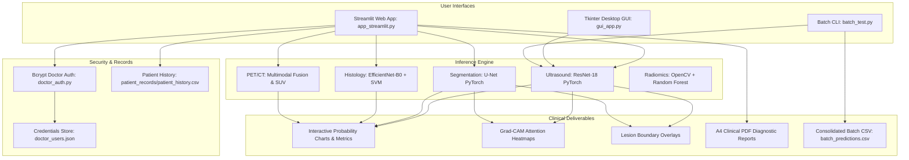

# 🩺 MammoAI: Multimodal Breast Cancer Detection & Explainable Decision Support System

[](https://www.python.org/)
[](https://pytorch.org/)
[](https://www.tensorflow.org/)
[](https://streamlit.io/)
[](https://scikit-learn.org/)
[](https://opencv.org/)
[](https://pydicom.github.io/)
[](https://arxiv.org/abs/1610.02391)
[](LICENSE)
[]()

> **An end-to-end, multi-modal clinical AI platform combining Deep Learning (ResNet-18, EfficientNet-B0, U-Net), Explainable AI (Grad-CAM), Classical Machine Learning (SVM, Random Forest), and Multimodal Fusion (PET/CT) to assist radiologists and oncologists with reliable, interpretable breast cancer triage and diagnosis.**

---

## 📑 Table of Contents

- [Overview & Clinical Motivation](#-overview--clinical-motivation)
- [Key Features](#-key-features)
- [Multi-Modal Diagnostic Capabilities](#-multi-modal-diagnostic-capabilities)
  - [1. Breast Ultrasound (BUS)](#1-breast-ultrasound-bus)
  - [2. Histopathology (H&E Biopsy)](#2-histopathology-he-biopsy)
  - [3. PET / CT Multimodal Fusion & Staging](#3-pet--ct-multimodal-fusion--staging)
- [System Architecture](#-system-architecture)
- [Explainability & Clinical Validation (XAI)](#-explainability--clinical-validation-xai)
- [Automated Clinical PDF Reporting](#-automated-clinical-pdf-reporting)
- [Project Directory Structure](#-project-directory-structure)
- [Model Zoo & Benchmarks](#-model-zoo--benchmarks)
- [Installation & Setup](#-installation--setup)
- [Running the Applications](#-running-the-applications)
  - [Interactive Web Portal (Streamlit)](#1-interactive-web-portal-streamlit)
  - [Desktop GUI (Tkinter)](#2-offline-desktop-gui-tkinter)
  - [Batch Inference CLI](#3-high-throughput-batch-cli)
  - [Classical ML Feature Pipeline](#4-classical-ml-feature-engineering-pipeline)
- [Doctor Authentication & Patient Records](#-doctor-authentication--patient-records)
- [Tech Stack](#-tech-stack)
- [Medical Disclaimer](#-medical-disclaimer)
- [Author & Acknowledgments](#-author--acknowledgments)

---

## 🌟 Overview & Clinical Motivation

Breast cancer remains one of the most frequently diagnosed malignancies globally. While early and accurate diagnosis dramatically increases 5-year survival rates, clinical workflows face critical hurdles:
- **High Radiologist Workload:** Evaluating hundreds of ultrasound and mammography scans daily leads to diagnostic fatigue.
- **Inter-Observer Variability:** Distinguishing complex benign fibroadenomas from early-stage malignant carcinomas can be ambiguous.
- **Multimodal Fragmented Data:** Ultrasound, PET/CT scans, and histopathology tissue biopsies are often analyzed in isolation rather than synergistically.
- **"Black-Box" AI Hesitancy:** Clinicians require transparent, explainable visualizations before trusting autonomous machine predictions.

**MammoAI** provides a unified clinical decision support platform addressing these bottlenecks. It integrates **ultrasound computer-aided diagnosis (CADx)**, **histopathological transfer learning**, and **metabolic/anatomical PET-CT fusion**, complemented by **Grad-CAM attention heatmaps**, **U-Net lesion contouring**, **SUV biomarker quantification**, and **instant downloadable clinical PDF reports**.

---

## 🚀 Key Features

| Feature | Description |
|---|---|
| **Multi-Modal Imaging Support** | Triage across **Ultrasound (BUS-UCLM)**, **Histopathology (BACH)**, and **PET/CT DICOM** volumes. |
| **Explainable AI (Grad-CAM)** | Real-time gradient-weighted class activation heatmaps overlaying suspect morphological regions. |
| **Lesion Segmentation (U-Net)** | Deep neural boundary delineation providing morphological masks and lesion contour overlays. |
| **PET/CT Fusion & Staging** | Automated color-mapped JET metabolic PET fusion over anatomical CT with proxy SUVmax/SUVmean metrics. |
| **Hybrid Deep-SVM Pipeline** | Pretrained **EfficientNet-B0** high-dimensional feature extractor coupled with calibrated **Support Vector Machines (SVM)**. |
| **Automated Clinical Reports** | Formatted **ReportLab A4 PDF generation** complete with patient ID, confidence distributions, and physician notes. |
| **Doctor Authentication & Audit** | Secure `bcrypt`-hashed clinician authentication (`doctor_auth.py`) and persistent non-duplicate patient record logs. |
| **Dual GUI Options** | Modern **Glassmorphic Streamlit Web Dashboard** + Native **Tkinter Desktop GUI** for offline clinic terminals. |
| **Batch Processing Engine** | Command-line batch inference script generating consolidated CSV predictions for high-volume hospital archives. |

---

## 🔬 Multi-Modal Diagnostic Capabilities

```
                           ┌──────────────────────────────┐
                           │      Patient Diagnostic      │
                           │       Scan Ingestion         │
                           └──────────────┬───────────────┘
                                          │
            ┌─────────────────────────────┼─────────────────────────────┐
            ▼                             ▼                             ▼
   ┌─────────────────┐           ┌─────────────────┐           ┌─────────────────┐
   │   Ultrasound    │           │ Histopathology  │           │   PET / CT      │
   │   (BUS-UCLM)    │           │ (ICIAR BACH)    │           │  (DICOM Series) │
   └────────┬────────┘           └────────┬────────┘           └────────┬────────┘
            │                             │                             │
    ┌───────┴───────┐             ┌───────┴───────┐             ┌───────┴───────┐
    │  ResNet-18    │             │EfficientNet-B0│             │ Slicing &     │
    │  Deep CNN     │             │  Extractor    │             │ Normalization │
    └───────┬───────┘             └───────┬───────┘             └───────┬───────┘
            │                             │                             │
    ┌───────┴───────┐             ┌───────┴───────┐             ┌───────┴───────┐
    │ Grad-CAM &    │             │ Calibrated    │             │ PET/CT Fusion │
    │ U-Net Mask    │             │ RBF Kernel SVM│             │ SUV Proxy     │
    └───────┬───────┘             └───────┬───────┘             └───────┬───────┘
            │                             │                             │
            └─────────────────────────────┼─────────────────────────────┘
                                          ▼
                           ┌──────────────────────────────┐
                           │   Consolidated Diagnosis,    │
                           │ Probability Spread & Reports │
                           └──────────────────────────────┘
```

### 1. Breast Ultrasound (BUS)
- **Architecture:** PyTorch ResNet-18 fine-tuned on the BUS-UCLM clinical benchmark.
- **Diagnostic Classes:** `Normal`, `Benign`, `Malignant`.
- **Explainability:** Interactive Grad-CAM heatmap visualization revealing acoustic shadows and architectural distortions driving the model's focus.
- **Segmentation:** PyTorch U-Net deep segmentation network segmenting lesion contours and computing area/aspect ratio metrics.
- **Interactive Visuals:** Plotly probability distributions and radar charts displaying diagnostic confidence.

### 2. Histopathology (H&E Biopsy)
- **Architecture:** Hybrid Transfer Learning Pipeline:
  - **Feature Representation:** Pre-trained **EfficientNet-B0** (`feature_extractor.keras`) extracting dense spatial representation vectors.
  - **Classification:** Scikit-Learn **Support Vector Machine (SVM)** with calibrated `predict_proba` (`svm_bach.joblib`).
  - **Alternate Neural Path:** Direct PyTorch ResNet-18 histopathology inference.
- **Diagnostic Categories:** Normal breast tissue, benign lesions, and malignant carcinoma.
- **Analytics:** Pixel intensity histograms and morphological feature analysis.

### 3. PET / CT Multimodal Fusion & Staging
- **Series Loader:** Ingestion of multi-slice DICOM series using `pydicom`, with patient position sorting and voxel volume reconstruction.
- **Metabolic & Anatomical Fusion:**
  - Standardized metabolic PET normalization.
  - Anatomical CT edge-enhancement via Canny operator filtering.
  - Alpha-blended JET colormap fusion (`cv2.addWeighted`).
- **Quantitative Biomarkers:**
  - **SUVmax (Proxy):** Peak focal metabolic absorption.
  - **SUVmean (Proxy):** Average metabolic uptake across segmented lesion.
  - **Metabolic Heterogeneity:** Uptake standard deviation across the target volume.
  - **Active Volume Percentage:** Percentage of tissue exceeding the metabolic threshold.
- **Automated Localization & Staging:** Quadrant detection (e.g., Upper Right, Lower Left) and metabolic stage stratification (`Stage 0 / Normal`, `Stage I`, `Stage II`, `Stage III / IV`).

---

## 🧠 System Architecture



---

## 🔍 Explainability & Clinical Validation (XAI)

Traditional black-box neural networks often fail regulatory and clinical compliance. **MammoAI** provides dual explainability:

1. **Grad-CAM (Gradient-Weighted Class Activation Mapping):**
   - Hooks into the final convolutional layer of ResNet-18 (`layer4`).
   - Computes gradients of the target class score with respect to feature activation maps.
   - Generates coarse 2D heatmaps highlighting discriminative acoustic regions (e.g., hypoechoic lesions, irregular borders).
2. **U-Net Lesion Segmentation & Contouring:**
   - Isolates the lesion area from normal parenchymal background.
   - Computes lesion-to-image area ratio and intensity contrast metrics.
3. **Automated Clinical Narrative:**
   - Synthesizes findings into natural-language clinical impressions based on confidence scores and morphological parameters.

---

## 📄 Automated Clinical PDF Reporting

With one click, physicians can generate a standardized **ReportLab-powered A4 Clinical Report** containing:
- 🏥 **Hospital & Department Header:** Professional clinical metadata and timestamps.
- 👤 **Patient Information:** Patient ID, name, date, time, and assigned radiologist.
- 🎯 **Diagnostic Assessment:** Primary classification with percentage confidence.
- 📊 **Class Probability Breakdown:** Granular probability table across all diagnostic classes.
- 📝 **AI Interpretation Narrative:** Objective breakdown of texture, margin characteristics, and activation density.
- ✍️ **Clinician Review Block:** Signature and credentialing section for final medical validation.

---

## 📁 Project Directory Structure

```text
Breast_Cancer_Detection/
├── app_streamlit.py             # Main Streamlit web application & clinical dashboard
├── doctor_auth.py               # Clinician authentication & session security (bcrypt)
├── doctor_users.json            # Registered doctor credentials store
├── gui_app.py                   # Standalone Tkinter desktop GUI application
├── predict.py                   # Modular inference functions (ResNet-18 & EfficientNet-SVM)
├── petct_inference.py           # DICOM loader, PET/CT fusion, and SUV analysis engine
├── ml_pipeline.py               # Classical ML pipeline (OpenCV radiomics + Random Forest)
├── batch_test.py                # Batch directory testing CLI script
├── batch_predictions.csv        # Exported predictions from batch image evaluation
├── breast_cancer_resnet18.pth   # Trained PyTorch ResNet-18 weights (Ultrasound & Histo)
├── feature_extractor.keras      # Trained EfficientNet-B0 Keras feature extraction model
├── svm_bach.joblib              # Calibrated Scikit-Learn SVM model for BACH histopathology
├── requirements.txt             # Comprehensive Python dependencies manifest
├── temp_histo_image.jpg         # Sample/cached histopathology test artifact
└── patient_records/             # Auto-generated patient history database
    └── patient_history.csv      # Persistent clinical records log
```

---

## 📊 Model Zoo & Benchmarks

| Modality | Architecture / Algorithm | Framework | Artifact File | Primary Dataset |
|---|---|---|---|---|
| **Ultrasound (BUS)** | ResNet-18 (Deep CNN) | PyTorch | `breast_cancer_resnet18.pth` | BUS-UCLM Benchmark |
| **BUS Segmentation** | U-Net (Encoder-Decoder) | PyTorch | Procedural / Built-in | BUS-UCLM Masks |
| **Histopathology** | EfficientNet-B0 + Calibrated SVM | Keras + Scikit-Learn | `feature_extractor.keras` + `svm_bach.joblib` | ICIAR 2018 BACH |
| **PET / CT** | Volumetric Fusion + SUV Radiomics | PyDICOM + OpenCV | `petct_inference.py` | Clinical DICOM Series |
| **Classical Radiomics** | Random Forest Classifier (200 trees) | Scikit-Learn | `ml_pipeline.py` | Morphological Feature Matrix |

---

## ⚡ Installation & Setup

### 1. Clone the Repository
```bash
git clone https://github.com/aleena6678/Breast_Cancer_Detection.git
cd Breast_Cancer_Detection
```

### 2. Create and Activate a Virtual Environment
```bash
# Windows (PowerShell)
python -m venv venv
.\venv\Scripts\Activate.ps1

# Linux / macOS
python3 -m venv venv
source venv/bin/activate
```

### 3. Install Dependencies
```bash
pip install --upgrade pip
pip install -r requirements.txt
```

> [!TIP]
> If using a CUDA-compatible NVIDIA GPU, install PyTorch with CUDA support from [pytorch.org](https://pytorch.org/get-started/locally/) for accelerated inference.

---

## 🖥️ Running the Applications

### 1. Interactive Web Portal (Streamlit)
Launch the primary clinical diagnostic suite:
```bash
streamlit run app_streamlit.py
```
Open your browser at `http://localhost:8501`.

#### 🔐 Clinician Login
The application starts with a secure login screen:
- **Default Test Accounts:** `Dr.Ann`, `Dr Smith`, `Dr Anu`
- **New Registration:** Clinicians can register on-the-fly with their Doctor ID and secure password.

#### 🎛️ Modality Selection
Navigate seamlessly between **Ultrasound**, **PET / CT**, and **Histopathology** using the modality selector tabs.

---

### 2. Offline Desktop GUI (Tkinter)
For offline clinics or triage stations without a web browser:
```bash
python gui_app.py
```
- Select any `.png`, `.jpg`, or `.jpeg` ultrasound image.
- View real-time diagnostic classification and confidence ratings in a native desktop window.

---

### 3. High-Throughput Batch CLI
Process entire hospital image archives and export results to CSV:
```bash
python batch_test.py
```
Outputs predictions and individual class probabilities to `batch_predictions.csv`:
```csv
filename,pred_class,prob_normal,prob_benign,prob_malignant
ALWI_000.png,benign,0.00675,0.99221,0.00102
ALWI_001.png,normal,0.99824,0.00157,0.00018
...
```

---

### 4. Classical ML Feature Engineering Pipeline
Train and evaluate classical mask-based radiomics:
```bash
python ml_pipeline.py
```
Extracts lesion area ratio, lesion intensity, image mean, and variance, training a Random Forest classifier with stratified cross-validation.

---

## 🔒 Doctor Authentication & Patient Records

- **Password Security:** All credentials in `doctor_users.json` are hashed using `bcrypt` with unique salts.
- **Patient History:** Inferences can be registered into `patient_records/patient_history.csv` with a unique Patient ID, timestamp, diagnosis, confidence score, and estimated disease stage.
- **Duplicate Prevention:** Built-in safeguards prevent re-logging duplicate Patient IDs on identical scans.

---

## 🛠️ Tech Stack

| Category | Technologies |
|---|---|
| **Core Language** | Python 3.10+ |
| **Deep Learning** | PyTorch, Torchvision, TensorFlow / Keras (EfficientNet-B0) |
| **Machine Learning** | Scikit-Learn (SVM, Random Forest), Joblib, NumPy, Pandas |
| **Medical Imaging** | PyDICOM, OpenCV (`cv2`), Pillow, NiBabel |
| **Web UI & Styling** | Streamlit, Streamlit-Lottie, Plotly Express & Graph Objects |
| **Desktop UI** | Tkinter |
| **PDF Reporting** | ReportLab |
| **Security** | Bcrypt |

---

## ⚠️ Medical Disclaimer

> **IMPORTANT CLINICAL NOTICE:**
> This software is developed for **academic, research, and educational decision-support purposes only**. It does not constitute a certified medical device and should **never** replace professional clinical judgment, histopathological biopsy confirmation, or formal radiologist review. Always consult a licensed healthcare professional for clinical diagnosis and treatment planning.

---

## 👩‍💻 Author & Acknowledgments

- **Developed by:** [Aleena Saji](https://github.com/aleena6678)
- **Datasets:**
  - **BUS-UCLM:** Breast Ultrasound Images Dataset (University of Castilla-La Mancha).
  - **ICIAR BACH:** Breast Cancer Histology Challenge Benchmark.
- **License:** Distributed under the [MIT License](LICENSE).

---

<p align="center">
  <b>MammoAI</b> — Empowering Clinicians with Accurate, Explainable Multimodal Breast Cancer Intelligence.
</p>
